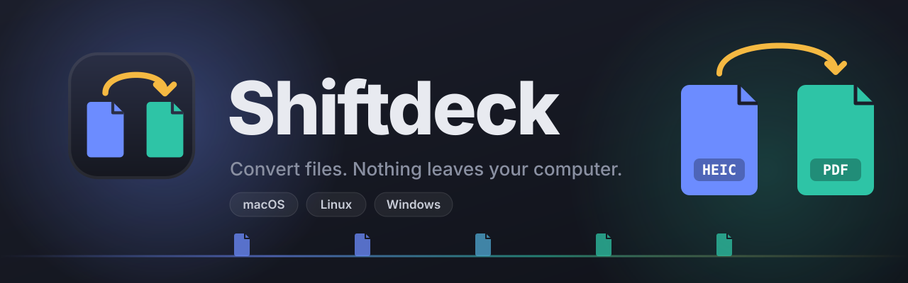
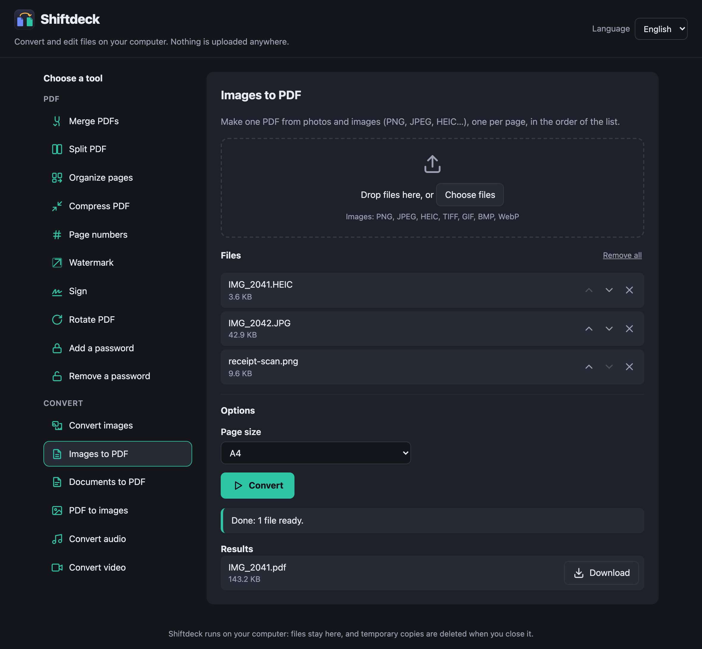

<p align="center">
  
</p>

<p align="center">
  <a href="https://github.com/azammarchi/shiftdeck/actions/workflows/ci.yml"></a>
  <a href="LICENSE"></a>
  
</p>

<p align="center">
  <a href="https://azammarchi.github.io/shiftdeck/"><strong>▶ Try the online demo</strong></a>
</p>

**Shiftdeck** converts and edits files on your computer, in a window in your browser. Merge, split and rotate PDFs, turn PDFs into images and photos into PDFs, add or remove a password. No accounts and no uploads: your files go from your browser to your own computer and nowhere else.

<p align="center">
  
</p>

## Try it online

The [online demo](https://azammarchi.github.io/shiftdeck/) runs **Convert images** and **Images to PDF** entirely inside your browser: your files never leave the page, and there's nothing to install. The other tools need programs a web page can't use, so they run in the app on your computer: the demo shows them and explains how to get it.

## Quick start

You need [Node.js](https://nodejs.org) 20 or newer. Then, in a terminal:

```bash
git clone https://github.com/azammarchi/shiftdeck.git
cd shiftdeck
npm run setup
npm start
```

- **`npm run setup`** installs the programs Shiftdeck's tools use, with your system's own package manager, and checks that they work. Run it once (and again any time: it only installs what's missing). LibreOffice, for documents, is a large download: `npm run setup -- --no-documents` leaves it out.
- **`npm start`** opens Shiftdeck in your browser at <http://localhost:5174>. When you close its tab, it stops by itself and deletes the temporary copies of your files.

## Features

- 📎 **Merge PDFs** in the order you choose
- ✂️ **Split a PDF** into single pages or page ranges (`1-3, 4, 5-8`)
- 🧩 **Organize pages**: see every page as a thumbnail, put them in a new order (drag them, or use the keyboard), turn single pages and remove the ones you don't want
- 🖼️ **PDF to images**: every page as PNG or JPEG, at the resolution you pick
- 📝 **Documents to PDF**: Word, Excel, PowerPoint, OpenDocument, RTF, HTML and plain text, laid out as they would print
- 🖼️ **Convert images** between PNG, JPEG, HEIC, WebP and TIFF, make them smaller, and remove their hidden details: where a photo was taken (GPS), the camera, the date
- 🎵 **Convert audio** between MP3, M4A, OGG, Opus, FLAC and WAV, or take the sound out of a video
- 🎬 **Convert video** to MP4, WebM, MOV or GIF, smaller (720p, 480p…) or without sound, with a progress bar and a Cancel button
- 📄 **Images to PDF**: PNG, JPEG, **HEIC** (iPhone photos), TIFF, GIF, BMP, WebP, one per page, on A4 or Letter pages turned to match each image, at full resolution
- 🔎 **Make searchable (OCR)**: read the text in scanned PDFs and photos of documents, in 12 languages, so it can be searched, selected and copied; the pages keep looking exactly the same. Or get just the text, as a `.txt` file
- 🔢 **Page numbers**: "1", "1 / 12" or "Page 1 of 12", in any corner or centred, from any number, with or without the first page
- ✍️ **Sign**: draw your signature with the mouse, a finger or a pen (or type your name) and place it on any page; only the ink goes on the page. It's a drawn signature, not a certified digital one
- 💧 **Watermark**: a faint DRAFT or CONFIDENTIAL (or any text) across every page, diagonal or horizontal
- 🗜️ **Compress PDF**: make a PDF lighter for email; scans and screenshots often shrink by 80–90%
- 🔄 **Rotate** every page of a PDF
- 🔒 **Add a password** with AES-256 encryption, and 🔓 **remove one** you know
- 🗂️ **Many files at once**: tools that work on one file do each of them in turn
- 🗜️ **Download all** the results of a run as one ZIP
- 💻 **macOS, Linux and Windows**
- 🌐 **12 languages**: English, Italiano, Español, Français, Deutsch, Português, Русский, 中文, 日本語, 한국어, हिन्दी, العربية (right to left), picked from your browser's language
- ♿ **Accessible**: keyboard-only use, screen reader labels and announcements, WCAG 2.1 AA contrast ([details](ACCESSIBILITY.md))
- 📦 **No npm dependencies**: plain HTML, CSS and JavaScript, plus well-known open-source converters

## On your desktop

```bash
npm run desktop
```

puts Shiftdeck on your desktop, so you can open it like any other app and send files to it from your file manager. They arrive in the app already loaded, with the right tool picked (several PDFs to merge, one to organize, pictures, sound, video and documents to convert):

| | Open Shiftdeck | Send it files |
| --- | --- | --- |
| **macOS** | **Shiftdeck** in your Applications folder (Launchpad, Spotlight, the Dock) | right-click → **Open With → Shiftdeck**, or drop them on its icon |
| **Windows** | **Shiftdeck** in the Start menu | right-click → **Send to → Shiftdeck** |
| **Linux** | **Shiftdeck** in your applications menu | right-click → **Open With → Shiftdeck**; in Files (Nautilus), **Scripts → Convert with Shiftdeck** |

Everything goes in your own folders, with no administrator rights; `npm run desktop -- --remove` takes it all away. If you move the Shiftdeck folder or reinstall Node, run `npm run desktop` again.

## Command line and watched folder

Every tool also works from a terminal, with the same engines:

```bash
npm install -g github:azammarchi/shiftdeck   # adds the shiftdeck command
```

```bash
shiftdeck                                          # opens the app, like npm start
shiftdeck tools                                    # which tools work on this computer
shiftdeck convert-images --format jpeg --max-size 1600 *.heic
shiftdeck merge chapter1.pdf chapter2.pdf --out ~/Desktop
shiftdeck compress --level smallest report.pdf
shiftdeck watch ~/Downloads/to-convert --tool convert-images --format jpeg
shiftdeck open scan.pdf photo.heic                 # opens the app with these files loaded
```

Results go to the current folder, or to `--out`, and never overwrite a file that's already there. `shiftdeck watch` converts every file that lands in a folder (once it has finished copying) into its `converted` subfolder, until you press Ctrl+C. `shiftdeck help` lists every tool's options.

## How it works

The page in your browser sends your files to a small server on your own computer (`server.js`, listening only on `localhost`), which runs the conversion and hands back the results as downloads. The conversions are done by **engines**, programs that `npm run setup` installs:

| Engine | Used for | macOS | Linux | Windows |
| --- | --- | --- | --- | --- |
| [qpdf](https://qpdf.readthedocs.io) | Merging, splitting, rotating, passwords (AES-256), stamping page numbers, signatures and watermarks, compressing | Homebrew | apt, dnf, pacman, zypper | winget, Chocolatey |
| [mutool](https://mupdf.com) (MuPDF) | PDF to images, page thumbnails | not needed | ✓ | ✓ |
| [ImageMagick](https://imagemagick.org) | Converting and reading images (HEIC included) | Homebrew | ✓ | ✓ |
| [FFmpeg](https://ffmpeg.org) | Converting audio and video | Homebrew | ✓ | ✓ |
| [LibreOffice](https://www.libreoffice.org) | Documents to PDF | Homebrew (cask) | ✓ | ✓ |
| [Tesseract](https://github.com/tesseract-ocr/tesseract) | OCR, with its language models for 12 languages | Homebrew | ✓ | ✓ |
| PDFKit (Apple) | Every PDF tool | built in | – | – |

On macOS, Apple's PDFKit, built into every Mac, already does all the PDF work, so `npm run setup` adds only qpdf (for strong passwords), ImageMagick (for images) and FFmpeg (for audio and video) there. If an engine is installed but doesn't start (a library it needs was updated, say), the app counts it as missing and `npm run setup` reinstalls it. When the server starts it prints which engines it found; a tool whose engine is missing says so in the app and tells you to run `npm run setup`.

| Environment variable | Effect |
| --- | --- |
| `PORT=8080` | Use a different port |
| `NO_OPEN=1` | Don't open the browser |
| `KEEP_RUNNING=1` | Keep the server running after the last tab closes |
| `SHIFTDECK_DISABLE_ENGINES=pdfkit` | Act as if an engine wasn't installed (`pdfkit`, `qpdf`, `mutool`, `imagemagick`, `ffmpeg`, `libreoffice`, `tesseract`) |

### Passwords

With qpdf, which `npm run setup` installs everywhere, passwords use **AES-256** encryption. If qpdf is missing on a Mac, Shiftdeck falls back to PDFKit, which can only write **RC4 128-bit**, an old and weak encryption, and tells you so plainly. Removing a password needs the password: Shiftdeck doesn't crack PDFs.

## Tests

Two layers, both on real files that the tests make fresh:

- **Engine tests** (`node --test`) run every tool and check the results: page counts, page sizes, rotation, image resolution, lossless images, encryption type, wrong passwords, odd file names, converted image formats and sizes, phone photos turned upright with their location removed, and that the ZIP behind **Download all** reads back intact. They run once for each set of engines the computer has: PDFKit on a Mac, and qpdf, mutool and ImageMagick anywhere.
- **Command-line tests** run the `shiftdeck` command and a watched folder.
- **End-to-end tests** ([Playwright](https://playwright.dev)) use the app like a person would, in **WebKit** (Safari's engine), **Firefox** and **Chromium**: picking tools, adding and reordering files, dragging pages, drawing a signature, options, progress and Cancel, errors, missing engines, downloads, languages, the online demo (which must never reach a server) and accessibility (with [axe-core](https://github.com/dequelabs/axe-core)).

```bash
npm install
npm run test:install
npm test
```

`npm install` only adds the test tools: the app itself has no npm dependencies. On GitHub, [CI](.github/workflows/ci.yml) runs everything on **macOS, Linux and Windows** on every push and pull request, each machine installing its engines with `npm run setup`.

## Roadmap

- **Certified digital signatures** (PAdES), with a certificate of your own
- **Installers** that need no terminal: a Homebrew tap, winget and a Linux package

Ideas and help are welcome: see [CONTRIBUTING.md](CONTRIBUTING.md).

## License

[MIT](LICENSE)
