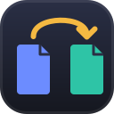

<p align="center">
  
</p>

<h1 align="center">Shiftdeck</h1>

<p align="center">
  <a href="https://github.com/azammarchi/shiftdeck/actions/workflows/ci.yml"></a>
  <a href="LICENSE"></a>
</p>

**Shiftdeck** converts and edits files on your Mac, in a window in your browser. Merge, split and rotate PDFs, turn PDFs into images and photos into PDFs, add or remove a password. No accounts and no uploads: your files go from your browser to your own Mac and nowhere else, and the converters are the ones built into macOS.

## Features

- 📎 **Merge PDFs** in the order you choose
- ✂️ **Split a PDF** into single pages or page ranges (`1-3, 4, 5-8`)
- 🖼️ **PDF to images**: every page as PNG or JPEG, at the resolution you pick
- 📄 **Images to PDF**: PNG, JPEG, **HEIC** (iPhone photos), TIFF, GIF, BMP, WebP, one per page, on A4 or Letter pages turned to match each image, at full resolution
- 🔄 **Rotate** every page of a PDF
- 🔒 **Add a password** (AES-256 with [qpdf](https://qpdf.readthedocs.io); see [Passwords](#passwords)) and 🔓 **remove one** you know
- 🗂️ **Many files at once**: tools that work on one file do each of them in turn
- 🌐 **English and Italiano**, picked from your browser's language
- ♿ **Accessible**: keyboard-only use, screen reader labels and announcements, WCAG 2.1 AA contrast ([details](ACCESSIBILITY.md))
- 📦 **Zero dependencies**: plain HTML, CSS and JavaScript, plus the converters macOS already has

## Run it

You need a Mac and [Node.js](https://nodejs.org) 20 or newer (no packages to install):

```bash
npm start
```

Your default browser opens at <http://localhost:5174>. If that port is busy, the next free one is used. When you close the app's tab the server stops by itself, and the temporary copies of your files are deleted.

| Environment variable | Effect |
| --- | --- |
| `PORT=8080` | Use a different port |
| `NO_OPEN=1` | Don't open the browser |
| `KEEP_RUNNING=1` | Keep the server running after the last tab closes |
| `SHIFTDECK_DISABLE_ENGINES=qpdf` | Act as if an optional engine wasn't installed |

## How it works

The page in your browser sends your files to a small server on your own Mac (`server.js`, listening only on `localhost`), which runs the conversion and hands back the results as downloads. The conversions are done by **engines**:

| Engine | Comes with | Used for |
| --- | --- | --- |
| **PDFKit** (Apple), through JavaScript for Automation | macOS | Every PDF tool |
| **qpdf** | `brew install qpdf` (optional) | AES-256 passwords |

When the server starts it prints which engines it found, and the app adapts to them.

### Passwords

macOS's own PDFKit can only protect a PDF with **RC4 128-bit** encryption, which is old and considered weak. Install qpdf to get **AES-256** instead:

```bash
brew install qpdf
```

Without qpdf, Shiftdeck still adds the password, but it tells you plainly that the protection is weak. Removing a password needs the password: Shiftdeck doesn't crack PDFs.

## Tests

Two layers, both on real files made fresh by the tests with the Mac's own tools:

- **Engine tests** (`node --test`) run every tool and check the results with PDFKit: page counts, page sizes, rotation, image resolution, encryption type, wrong passwords, odd file names.
- **End-to-end tests** ([Playwright](https://playwright.dev)) use the app like a person would, in **WebKit** (Safari's engine), **Firefox** and **Chromium**: picking tools, adding and reordering files, options, errors, downloads, languages and accessibility (with [axe-core](https://github.com/dequelabs/axe-core)).

```bash
npm install
npm run test:install
npm test
```

`npm install` only adds the test tools: the app itself has no dependencies. On GitHub, [CI](.github/workflows/ci.yml) runs everything on macOS, with qpdf installed, on every push and pull request.

## Roadmap

Shiftdeck aims to become a single local converter for the files you deal with every day, always with the Mac's own tools first and optional engines for the rest:

- **Images**: PNG, JPEG, HEIC, TIFF… to each other, with resizing (`sips`)
- **Audio**: WAV, AIFF, M4A/AAC… (`afconvert`), more with ffmpeg
- **Video**: MOV/MP4 (`avconvert`), MKV, WebM, GIF with ffmpeg
- **Documents**: DOCX, RTF, HTML, TXT (`textutil`), DOCX to PDF with LibreOffice
- **More PDF tools**: compress, reorder and delete pages, a drawn signature, page numbers, OCR
- **Finder Quick Actions** and a watched folder

Ideas and help are welcome: see [CONTRIBUTING.md](CONTRIBUTING.md).

## License

[MIT](LICENSE)
